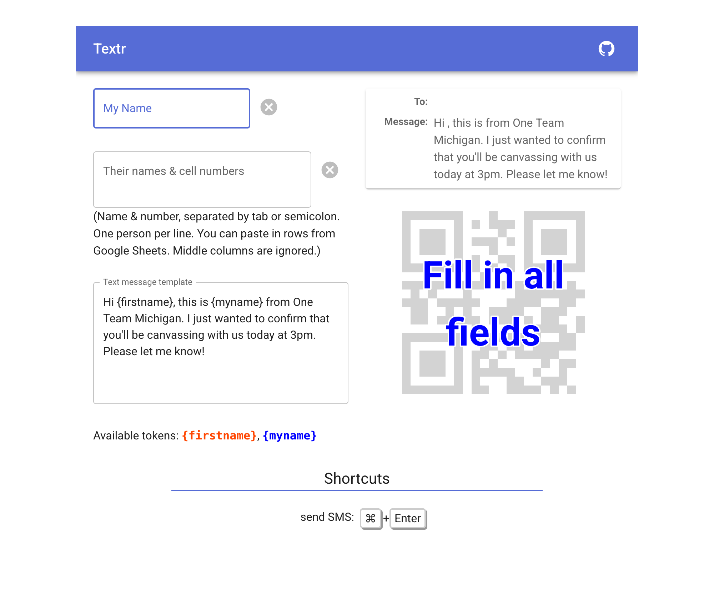

# Textr

<h3 align="center">
☎️ <a href="https://textr-mi.netlify.app/">textr-mi.netlify.app</a> ☎️
</h3>


Textr is a free tool that makes volunteer confirms faster and less error-prone. Stop fat-fingering numbers or sending a text with the wrong name.

## How it works



1. On your laptop, load up the site and enter your name to personalize your texts.
2. Paste in your list of people. Each line needs a name and a phone number, separated by a tab or semicolon. You can copy rows straight out of Google Sheets, and any columns between the name and the number are ignored.
3. Write your message template. `{firstname}` and `{myname}` are filled in for each person.
4. Send the text, or call, with one click or a keyboard shortcut. Or scan the "text" or "call" QR codes with your phone.
5. Use the arrows or a shortcut to move on to the next person.

The default message mentions Michigan, but you can change it to say whatever you like. Your name and message template are saved in a cookie, so they'll still be there next time. All data stays on your device.

## Development

```bash
npm install
npm run dev
```

Built with Next.js and Material UI. Feedback and pull requests are welcome!
